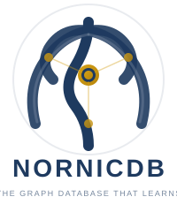

<p align="center">
  
</p>

<h1 align="center">NornicDB</h1>

<p align="center">
  <strong>Graph, vector, and historical truth in one database</strong><br/>
  Neo4j-compatible • Hybrid graph + vector retrieval • Historical reads via MVCC<br/>
  <em>Achieving Psygnosis for AI</em>
  <p align="center">
  Multi-arch support: CPU | CUDA | Metal | Vulkan
  <p align="center">
</p>

<p align="center">
  
  <a href="https://coveralls.io/github/orneryd/NornicDB?branch=main"></a>
  <a href="https://hub.docker.com/u/timothyswt"></a>
  <a href="https://neo4j.com/"></a>
  <a href="https://github.com/qdrant/qdrant"></a>
  <a href="https://go.dev/"></a>
  <a href="https://goreportcard.com/report/github.com/orneryd/nornicdb"></a>
  <a href="LICENSE.md"></a>
</p>
<p align="center">
  <a href="https://discord.gg/yszYHrxp4N"></a>
</p>

<p align="center">
  <a href="#quick-start">Quick Start</a> •
  <a href="#what-nornicdb-is">What It Is</a> •
  <a href="#why-nornicdb-is-different">Why NornicDB</a> •
  <a href="#performance-snapshot">Benchmarks</a> •
  <a href="#features">Features</a> •
  <a href="#documentation">Docs</a> •
  <a href="#comparison">Comparison</a> •
  <a href="#contributors">Contributors</a>
</p>

## Quick Start

### Docker and Homebrew

```bash
# Homebrew
brew tap orneryd/nornicdb && brew install nornicdb && brew services start nornicdb

# arm64 / Apple Silicon
docker run -d --name nornicdb -p 7474:7474 -p 7687:7687 -v nornicdb-data:/data timothyswt/nornicdb-arm64-metal-bge:latest

# amd64 / CPU only
docker run -d --name nornicdb -p 7474:7474 -p 7687:7687 -v nornicdb-data:/data timothyswt/nornicdb-amd64-cpu-bge:latest
```

Open [http://localhost:7474](http://localhost:7474) for the admin UI. For an authenticated, loopback-only setup and your first query, follow the [quick start guide](docs/start.md). For NVIDIA CUDA hosts, use `timothyswt/nornicdb-amd64-cuda-bge:latest`. For Vulkan hosts, use `timothyswt/nornicdb-amd64-vulkan-bge:latest`.

---

> Note: Docker on macOS does not expose Metal acceleration. The Apple Silicon image still runs, but GPU acceleration on macOS requires a native install from the [releases page](https://github.com/orneryd/NornicDB/releases) or a local build.

---

### Local build

Install the [build prerequisites](docs/development/setup.md), then clone, build, and start the server:

```bash
git clone https://github.com/orneryd/NornicDB.git
cd NornicDB
make build
./bin/nornicdb serve
```

On Windows, run `.\bin\nornicdb.exe serve`. See [configuration](docs/operations/configuration.md) for authentication and storage settings.

### macOS release installer

Download the `.pkg` installer for your Mac from the [release assets](https://github.com/orneryd/NornicDB/releases): choose `arm64` for Apple Silicon or `amd64` for Intel. Open the package and follow its installer prompts. Homebrew is also available above.

## What NornicDB Is

NornicDB is a graph database that combines Cypher queries, graph traversal, vector search, and historical reads. It supports Bolt and HTTP interfaces and can be embedded in Go applications.

## Why NornicDB Is Different

- Query connected data using Cypher and compatible Bolt drivers.
- Combine graph traversal with vector and full-text retrieval.
- Model historical state with MVCC and retained history.
- Run with CPU or supported GPU acceleration, or embed the database in a Go application.

See [features](#features), [architecture](docs/architecture/README.md), and the [project details](docs/project-details.md) for capabilities, deployment patterns, and tradeoffs.

## Performance Snapshot

Benchmark results depend on workload and hardware. Explore the [performance guides](docs/performance/README.md), including [Northwind](docs/performance/1.1.0-northwind-results/comparison.md), [hybrid retrieval](docs/performance/hybrid-query-benchmarks.md), and [retrieval quality](docs/performance/retrieval-recall-benchmark.md).

## Features

- [Cypher queries and functions](docs/user-guides/cypher-queries.md) and [Neo4j migration](docs/neo4j-migration/README.md).
- [Vector search](docs/user-guides/vector-search.md), [memory policies](docs/user-guides/knowledge-layer-policies.md), and [agent integration](docs/skills/README.md).
- [Transactions](docs/user-guides/transactions.md), [historical reads](docs/user-guides/historical-reads-mvcc-retention.md), and [durability](docs/operations/durability.md).
- [Embedding in Go](docs/development/embedding.md), [configuration](docs/operations/configuration.md), and [deployment](docs/operations/deployment.md).

## Documentation

Visit the [documentation site](https://orneryd.github.io/NornicDB/) for guides, API references, operations, and code exploration. The [project details](docs/project-details.md) retain the full setup, features, benchmark, image, configuration, and roadmap information.

## Comparison

Review the [Neo4j compatibility guide](docs/neo4j-migration/cypher-compatibility.md), [migration guides](docs/neo4j-migration/README.md), and the [documented comparisons](docs/project-details.md#comparison) when evaluating a migration.

## Contributors

Contributions are welcome. See the [contribution guide](CONTRIBUTING.md) and [contributors](CONTRIBUTORS.md).

## License

NornicDB is [MIT licensed](LICENSE.md). See [PATENTS.md](PATENTS.md) for the defensive patent grant and [NOTICES.md](NOTICES.md) for third-party notices.

<p align="center">
  <em>Psygnosis is a play on words or portmanteau meaning “mind" + "knowledge” in greek</em>
</p>
