# Cypher Parser Modes

> **Environment Variable:** `NORNICDB_PARSER`  
> **Options:** `nornic` (default) | `antlr`

NornicDB supports two Cypher parser implementations that can be switched at runtime.

## Architecture

```mermaid
%%{init: {'theme': 'dark', 'themeVariables': { 'primaryColor': '#1f6feb', 'primaryTextColor': '#c9d1d9', 'primaryBorderColor': '#30363d', 'lineColor': '#8b949e', 'secondaryColor': '#238636', 'tertiaryColor': '#21262d', 'background': '#0d1117', 'mainBkg': '#161b22'}}}%%

flowchart TB
    subgraph ENV["🔧 Configuration"]
        direction LR
        E1["NORNICDB_PARSER"]
        E2["nornic | antlr"]
    end

    Q[/"Cypher Query"/]
    
    Q --> VALIDATE["validateSyntax()"]
    
    VALIDATE --> |"NORNICDB_PARSER=nornic"| NORNIC
    VALIDATE --> |"NORNICDB_PARSER=antlr"| ANTLR
    
    subgraph NORNIC["⚡ Nornic Parser (Default)"]
        direction TB
        N1["Scannerless recursive descent"]
        N2["Top-level keyword/operator scans"]
        N3["Direct execution"]
        N1 --> N2 --> N3
    end
    
    subgraph ANTLR["🌳 ANTLR Parser"]
        direction TB
        A1["ANTLR Lexer"]
        A2["ANTLR Parser"]
        A3["Full Parse Tree"]
        A4["Syntax Validation"]
        A1 --> A2 --> A3 --> A4
    end
    
    NORNIC --> EXEC["Execute Query"]
    ANTLR --> EXEC
    EXEC --> RESULT[("Result")]
    
    style ENV fill:#21262d,stroke:#30363d
    style NORNIC fill:#161b22,stroke:#238636
    style ANTLR fill:#161b22,stroke:#a371f7
    style RESULT fill:#238636,stroke:#3fb950
```



## Historical Northwind measurements

These recorded figures describe an earlier implementation. They do not qualify
v1.4.4 or establish its current parser-mode ratios. Measure the complete query
workload, including shared semantic and result-column compilation, on the
revision and hardware being deployed.

| Query |  Nornic |  ANTLR | Slowdown |
|-------|----------|----------|----------|
| Count all nodes | 3,272 hz | 45 hz | **73x** |
| Count all relationships | 3,693 hz | 50 hz | **74x** |
| Find customer by ID | 4,213 hz | 2,153 hz | 2x |
| Products supplied by supplier | 4,023 hz | 53 hz | **76x** |
| Supplier→Category traversal | 3,225 hz | 22 hz | **147x** |
| Products with/without orders | 3,881 hz | 0.82 hz | **4,753x** |
| Create/delete relationship | 3,974 hz | 62 hz | **64x** |

**Total test suite time:**
| Mode | Time |
|------|------|
|  Nornic | 17.5s |
|  ANTLR | 35.3s (2x slower) |

## Mode Comparison

| Feature |  Nornic (Default) |  ANTLR |
|---------|---------------------|----------|
| **Throughput** | 3,000-4,200 ops/sec | 0.8-2,100 ops/sec |
| **Worst Case** | - | **4,753x slower** |
| **Error Messages** | Classified with restored line/column positions | Detailed (line/column) |
| **Syntax Validation** | Strict, TCK-vetted (see below) | Strict OpenCypher |
| **Memory Usage** | Scannerless syntax path plus shared retained grammar products | Grammar syntax validation plus shared retained products |
| **Best For** | **Production** | Development/Debugging |

> **Note:** both modes share a single converged execution pipeline. There are no
> legacy alternate executors or text re-dispatch fallbacks: every statement runs
> through the same typed router (`Handled` / `NotApplicable` / `ParseRejected` /
> `Failed`), and unhandled statements fail with Neo4j's `Neo.ClientError.Statement.SyntaxError`
> classification rather than being re-routed.

### Retained syntax in shared readers

The default Nornic parser remains scannerless recursive descent. Both modes also
use the same grammar products for semantic scope, result columns, CALL imports,
projection items and iteration bindings. Those shared readers can allocate a
retained tree even when the Nornic syntax parser itself needs no lexer or tree.

A reader that already holds a statement or clause consumes its original syntax
node. It does not rebuild each WITH item as a RETURN statement or parse every
CALL body and query suffix again. Genuine standalone source inputs still enter
through the same grammar owner. SLL prediction retries with LL when required;
the runtime and generated grammar remain unchanged.

For Go consumers, `StatementSyntax.LeadingCall(from)` now takes an original-source
byte offset. Pass `0` for a standalone source, or the clause's original offset
to select its frame in a retained statement. Leading whitespace/comments are
allowed; a window cutting a live token is refused, and a later CALL cannot
replace the frame at that window. Returned spans remain absolute, including
OPTIONAL CALL and rewritten Unicode source. For example, a standalone
`CALL () { RETURN 1 AS value }` uses `syntax.LeadingCall(0)`. An admitted
`MATCH (n) CALL (n) { RETURN n AS value } RETURN value` uses the retained
CALL token's offset with `syntax.LeadingCall(offset)`.

### Cancellation granularity in the ANTLR runtime

NornicDB pins `github.com/antlr4-go/antlr/v4` v4.13.1. Its internal prediction expansion does not provide a cancellation checkpoint. NornicDB's character and token streams check the request context, but an in-progress prediction step can finish before the runtime observes those streams again. A query deadline therefore does not impose a hard allocation or elapsed-time bound on that step, especially with cold prediction state.

This also affects shared grammar-based semantic and result-column readers reached from the default `nornic` mode; changing parser modes does not guarantee avoiding the limitation.

Earlier integrated revisions reproduced allocations above the unchanged `TestSelectedPathCountedCompilation` 8 MiB cap with a 5 ms deadline in three fresh processes. After the completed reader and owner convergence, the unchanged test passed in three fresh processes, with the million-step empty-graph cases allocating 7,578,048–8,229,080 bytes. These passing controls do not establish a hard allocation bound across cold prediction states: the runtime checkpoint limitation above remains. No test was skipped and no assertion or threshold was relaxed. Run the focused guard with:

```bash
go test ./pkg/cypher -run '^TestSelectedPathCountedCompilation$' -count=1 -v
```

As checked on 24 October 2026, [the official Go runtime release](https://github.com/antlr4-go/antlr/releases/tag/v4.13.1) is still v4.13.1 and [upstream prediction source](https://github.com/antlr4-go/antlr/blob/4d7e18847d8881a176db3d7cca909e3f3942a05f/parser_atn_simulator.go) matches the pinned dependency. No newer released fix was available. The runtime remains unmodified.

### Nornic validation is TCK-vetted

The Nornic parser is a **scannerless recursive descent parser**: it descends over
the raw query text with no separate lexer, and precedence is handled by recursive
splitting at the top-level occurrence of each operator (`findTopLevelOperator`,
`pkg/cypher/operators.go`), with quote/comment/bracket-aware fragment consumption
shared by all callers (`pkg/cypher/keyword_scan.go`). The official OpenCypher TCK is pinned at
revision `370fe27f` and the ratchet records **7794/7794 scenario/mode outcomes
passing** with zero expected gaps, setup blocks or harness errors
(`make cypher-tck-ratchet`, `make cypher-tck-vetted`). Rejections are classified
with Neo4j Bolt status codes and error positions are restored from the original
query text, including CR/CRLF/LF line counting.

## Configuration

```bash
# Production (default) - fastest
export NORNICDB_PARSER=nornic

# Development/Debugging - strict validation, better errors
export NORNICDB_PARSER=antlr
```

## Programmatic Switching

```go
import "github.com/orneryd/nornicdb/pkg/config"

// Check current parser
if config.IsNornicParser() {
    // Using fast Nornic parser
}

// Switch to ANTLR temporarily
cleanup := config.WithANTLRParser()
defer cleanup()
// ... queries use ANTLR parser here

// Direct set
config.SetParserType(config.ParserTypeANTLR)
config.SetParserType(config.ParserTypeNornic)
```

## When to Use Each Parser

### Nornic Parser (`NORNICDB_PARSER=nornic`) — **Default**

**Use when:**
- Production deployments
- Maximum performance is critical
- Simple, well-tested query patterns
- High-throughput workloads

**Pros:**
- **Fastest execution** — 3,000-4,200 ops/sec
-  **Scannerless syntax validation** — shared readers retain their own grammar products
-  **Battle-tested** — Original implementation, converged single pipeline
-  **Direct syntax path** — scannerless recursive descent without a separate lexer

**Cons:**
-  **Shared compilation still has a cost** — semantic and result-column readers use retained grammar products; measure the whole request

---

### ANTLR Parser (`NORNICDB_PARSER=antlr`)

**Use when:**
- Development and debugging
- Need detailed syntax error messages
- Strict OpenCypher compliance required
- Building query analysis tools

**Pros:**
-  **Strict validation** — Full OpenCypher grammar
-  **Detailed errors** — Line and column numbers
-  **Full parse tree** — For analysis/tooling
-  **Extensible** — Easy to add new features

**Cons:**
-  **Much slower** — 50-5000x slower than Nornic
-  **Higher memory** — Full parse tree allocation
-  **Not for production** — Too slow for high-throughput

## Error Message Comparison

**Invalid query:** `MATCH (n RETURN n` (missing closing paren)

| Parser | Error Message |
|--------|---------------|
| Nornic | `syntax error: unbalanced parentheses` classified as `Neo.ClientError.Statement.SyntaxError` (offset-tracked errors additionally restore line/column positions from the original query text) |
| ANTLR | `syntax error: line 1:9 no viable alternative at input 'MATCH (n RETURN'` |

## Make Targets

```bash
# Run entire test suite with ANTLR parser
make antlr-test

# Run cypher tests with both parsers
make test-parsers

# Regenerate ANTLR parser from grammar
make antlr-generate
```

## Files

| File | Description |
|------|-------------|
| `pkg/config/feature_flags.go` | Parser type configuration |
| `pkg/cypher/executor.go` | `validateSyntax()` dispatcher |
| `pkg/cypher/antlr/` | ANTLR parser implementation |
| `pkg/cypher/antlr/*.g4` | ANTLR grammar files |

---

**TL;DR:** Use `nornic` (default) for production. Use `antlr` only for development/debugging when you need detailed error messages.
