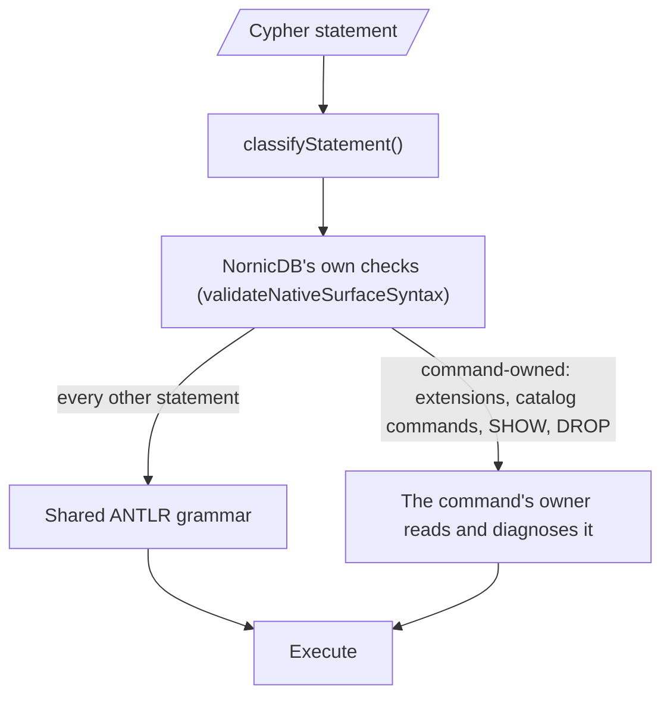

# Cypher Statement Admission

> **Environment Variable:** `NORNICDB_PARSER`
> **Options:** `nornic` (default) | `antlr`, kept for compatibility. It no
> longer selects how statements are validated.

Every statement is admitted the same way, whichever value `NORNICDB_PARSER`
has. Two parsers no longer give two sets of error messages.

## How a statement is admitted



1. `classifyStatement` (`pkg/cypher/statement_class.go`) reads the statement
   once, without its `EXPLAIN`/`PROFILE` and `USE` prefixes and its `CYPHER`
   preamble. It is the one owner of the statement's kind: which command it is
   (one recognizer, `pkg/cypher/statement_command.go`), every fact of that
   command (one table: catalog, schema, administration, transaction control,
   the schema and admin permissions, the state it changes), whether it is a
   graph query (the grammar's graph-query starts) and whether its command
   owner reads it. The execution contract takes a command's effect from that
   table and a graph statement's from the grammar; every state-change and
   permission decision reads that one answer.
2. NornicDB's own checks run first, with the same codes and messages for every
   statement (for example `query must start with a valid clause`, or
   `an expression is followed by another expression without an operator`).
3. Command-owned statements are NornicDB's extensions (knowledge-policy and
   procedure DDL, database limits and options, privilege commands, schema
   commands), the catalog commands (`CREATE`/`DROP`/`ALTER` `DATABASE`,
   composite databases, aliases, `SHOW DATABASES`) and every `SHOW` and `DROP`
   command. Their owners give the diagnostics, for example
   `invalid DROP DATABASE syntax: database name expected`.
4. Every other statement is checked by the shared ANTLR grammar
   (`pkg/cypher/antlr/CypherParser.g4`). A rejection is reported as
   `Neo.ClientError.Statement.SyntaxError` with its line and column in the
   submitted text.

The verdict is cached per statement text, and statements that differ only in
literal values share it, so a repeated statement is not parsed again.

### Cancellation granularity in the ANTLR runtime

NornicDB pins `github.com/antlr4-go/antlr/v4` v4.13.1. Its internal prediction expansion does not provide a cancellation checkpoint. NornicDB's character and token streams check the request context, but an in-progress prediction step can finish before the runtime observes those streams again. A query deadline therefore does not impose a hard allocation or elapsed-time bound on that step, especially with cold prediction state.

This affects statement admission and the shared grammar-based semantic and result-column readers whatever `NORNICDB_PARSER` is set to.

Earlier integrated revisions reproduced allocations above the unchanged `TestSelectedPathCountedCompilation` 8 MiB cap with a 5 ms deadline in three fresh processes. After the completed reader and owner convergence, the unchanged test passed in three fresh processes, with the million-step empty-graph cases allocating 7,578,048–8,229,080 bytes. These passing controls do not establish a hard allocation bound across cold prediction states: the runtime checkpoint limitation above remains. No test was skipped and no assertion or threshold was relaxed. Run the focused guard with:

```bash
go test ./pkg/cypher -run '^TestSelectedPathCountedCompilation$' -count=1 -v
```

As checked on 24 October 2026, [the official Go runtime release](https://github.com/antlr4-go/antlr/releases/tag/v4.13.1) is still v4.13.1 and [upstream prediction source](https://github.com/antlr4-go/antlr/blob/4d7e18847d8881a176db3d7cca909e3f3942a05f/parser_atn_simulator.go) matches the pinned dependency. No newer released fix was available. The runtime remains unmodified.

### TCK coverage

The official OpenCypher TCK is pinned at
revision `370fe27f` and the ratchet records **7794/7794 scenario/mode outcomes
passing** with zero expected gaps, setup blocks or harness errors
(`make cypher-tck-ratchet`, `make cypher-tck-vetted`). Rejections are classified
with Neo4j Bolt status codes and error positions are restored from the original
query text, including CR/CRLF/LF line counting.

## Files

| File | Description |
|------|-------------|
| `pkg/cypher/statement_class.go` | `classifyStatement`: statement kind and the command-owned rule |
| `pkg/cypher/statement_command.go` | The one command recognizer and the one table of command facts |
| `pkg/cypher/statement_execution_contract.go` | The statement's effect: a command's change, or the grammar's effects |
| `pkg/cypher/executor_query_routing.go` | `validateStatementSyntax`: the one statement admission owner |
| `pkg/cypher/antlr/` | Shared ANTLR grammar and parser |
| `pkg/config/feature_flags.go` | `NORNICDB_PARSER` (kept for compatibility) |

## Make Targets

```bash
# Regenerate the ANTLR parser from the grammar
make antlr-generate
```
