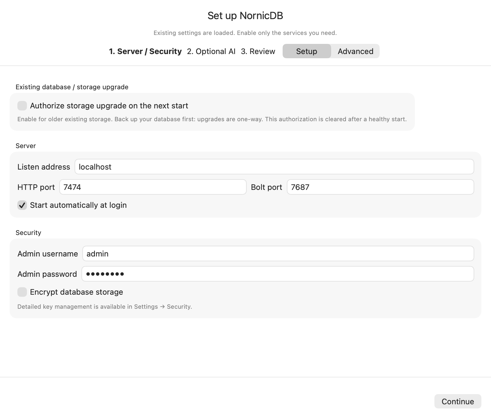
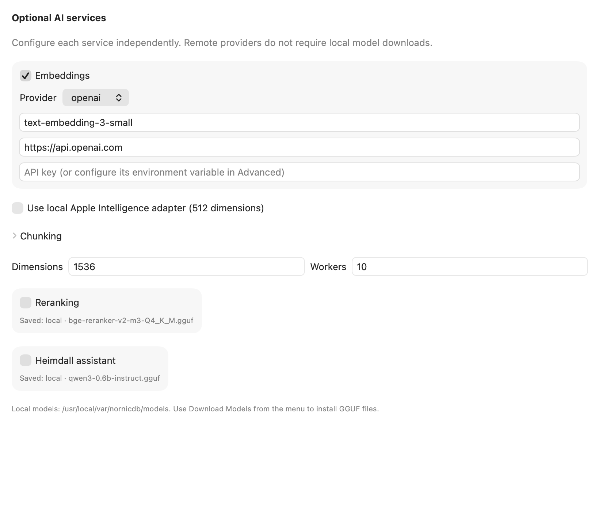
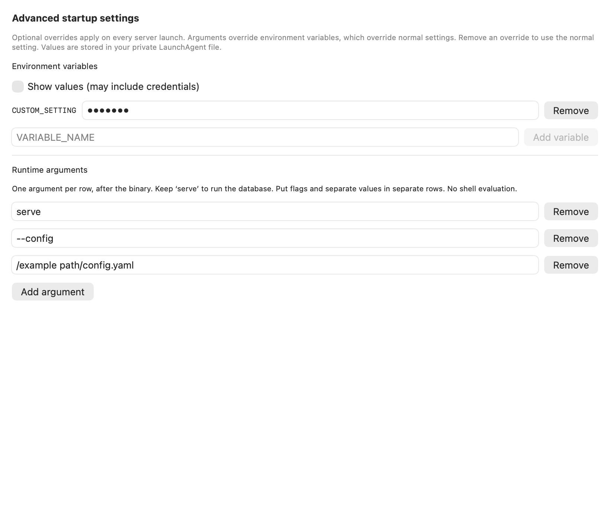

# macOS configuration preservation verification

Branch: `fix/macos-provider-settings`, based on release/v1.4.4 at
`1b669792a3c84a4def31e1419590f71d9f42feef`.

## Established defect and correction

Three fail-first Swift tests reproduced external embedding/reranking provider
replacement and remote model IDs acquiring `.gguf`. The shared config owner now
preserves providers, endpoints, credentials, model IDs and unknown YAML settings.
The same tests pass after correction. Setup has no preset application path.

The previous postinstall deleted the existing server LaunchAgent and created a
first-run marker on every upgrade. Running its actual source in an isolated
filesystem reproduces those changes; the replacement script preserves existing
files and only initializes fresh installations. Both editions and the direct
installer use that owner. Startup reload tests prove updated arguments/environment
are read before service start, including failure propagation.

## Completed checks (October 18, 2026, America/Phoenix)

- `swift test --package-path macos/MenuBarApp`: ten tests passed.
- `swift test --enable-code-coverage --package-path macos/MenuBarApp`: ten tests
  passed; coverage artifact generated. This is focused coverage, not a claim of
  complete UI interaction coverage.
- `python3 -m unittest discover -s macos/tests -v`: two tests passed against the
  actual postinstall with isolated paths and mocked privileged/launchd commands.
- `bash -n` for preinstall, postinstall, install.sh and build-installer.sh: passed.
- Native Swift release app and native Go server with embedded web UI: built.
  The initial default Homebrew Node failed to load ICU; retry using the configured
  interactive-shell Node succeeded. An earlier overlapping Swift build was
  canceled by its source changing; a subsequent frozen-source release build passed.
- Lite and Full PKG/DMG artifacts built locally.
- Initial Full package installed successfully. SHA-256 checks confirmed the
  restored config YAML, private environment file and server LaunchAgent remained
  byte-for-byte unchanged. The installed server became healthy and its authenticated
  API reported OpenAI `text-embedding-3-small`, 1536 dimensions, and the existing
  66,368-node `nornicdbcode` graph. LaunchAgent worker count is ten.

## Incomplete or blocked

- Live upgrade exposed the root installer's legacy `launchctl load` domain issue.
  Postinstall now explicitly bootstraps/kickstarts `gui/<uid>` and its isolated
  tests assert those commands. Corrected packages built. A second privileged
  installation was canceled at authentication; that final installer path has not
  received a complete privileged rerun. The already-installed app/server remain.
- Stop/Restart cancellation, three-step layout, and Advanced editing still need
  manual UI acceptance. Native compilation is not visual acceptance.
- `make verify-list BASE=origin/release/v1.4.4` and
  `make verify BASE=origin/release/v1.4.4` were attempted. The selftest fixture
  commits were blocked by the mandatory global duplicate hook. After the maintainer
  requested temporary local pre-commit disablement, the list rerun reached main-ref
  fixture updates and triggered the remaining ingestion hook. It was canceled.
  Only its five explicitly new databases (`plan`, `rename-1` through `rename-4`)
  were removed via the API. Full downstream verification remains unexecuted.
- The embedding regeneration API accepted a request; its completed clear reported
  2,293 embeddings. That endpoint clears the server's default scope. This does not
  prove that the code database's existing embeddings were reset. Complete the
  requested code-graph regeneration through a verified scoped path before resuming
  #1487. Ordinary OpenAI processing is running; zero pending has not been established.
- The maintainer clarified that there is no additional feature request. All
  installed duplication/ingestion Git hooks are now paused as `.disabled` files
  at their explicit request. A subsequent full `make verify-list` passed without
  fixture ingestion. Full verification is being rerun with that local state.

No CI job was dispatched and no release branch was merged or tagged. Performance
benchmarks are not applicable: this PR changes native configuration UI and installer
scripts, not database query execution.

## Native layout review

These are offscreen native SwiftUI captures using fixture settings, not screenshots
of private live credentials. They establish layout and native rendering, not mouse
interaction or launchd behavior. The temporary capture harness was removed after
review; ten deterministic configuration/startup regression tests remain.

The first step now uses compact fields, disabled services show their saved provider
and model, and Advanced has explicit optional value reveal. Argument rows retain
all arguments after the binary, including the existing position of `serve`.

Maintainer layout correction: the shared one-time storage upgrade control is at
the front of the first setup page and on Review, never under Advanced. Layout
captures above reflect this correction.
