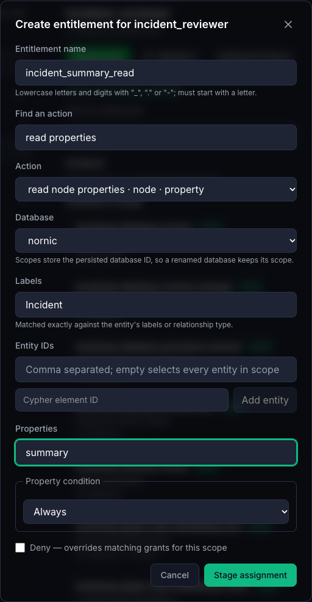

# Fine-grained access control

FGAC is opt-in. With it disabled, NornicDB uses the existing role entitlements,
per-database allowlist, and database privileges. With it enabled, authenticated
users keep their role memberships and the runtime evaluates the privileges and
fine-grained entitlements assigned to those roles. A matching deny takes
precedence over grants across roles.

## Enable FGAC

In the server configuration, set:

```yaml
auth:
  fgac_enabled: true
```

The equivalent environment setting is `NORNICDB_FGAC_ENABLED=true`. Restart the
server to change modes. FGAC requires authentication and a writable system role
store. On first activation with an empty catalog, NornicDB grants the built-in
administrator explicit control of the registered operations. The automatic
`PUBLIC` membership grants access to the user's home database and execution
access to procedures and functions. Each procedure still enforces the access
required by its underlying operation. These public privileges can be revoked.

After enabling FGAC on an existing installation, open **Database Access** to
map existing role memberships to fine-grained entitlements. Catalog edits must
preserve policy-management access for the built-in administrator.

With FGAC off, RBAC uses its own records and the FGAC catalog stays dormant on
disk. The FGAC routes and editor are available only while FGAC is on. During
reactivation, a renamed role keeps its policy and a deleted role loses its
assignments, even when a new role uses the same name. Custom assignments
created by the earlier development checkpoint need to be assigned again.

To resume legacy RBAC, restart with FGAC disabled. If a catalog is damaged,
restore a known-good system backup before enabling FGAC again.

## Configure graph privileges over Bolt

Run security administration statements on the `system` database. In this
example, the application database is `nornic`:

```cypher
CREATE ROLE article_reader IF NOT EXISTS;
GRANT ACCESS ON DATABASE nornic TO article_reader;
GRANT TRAVERSE ON GRAPH nornic NODES Article TO article_reader;
GRANT READ {title, summary} ON GRAPH nornic NODES Article TO article_reader;
GRANT ROLE article_reader TO alice;
SHOW ROLE article_reader PRIVILEGES AS COMMANDS;
```

Alice can match `Article` nodes. Cypher sees unreadable properties as absent,
including while evaluating predicates, projection, and aggregation. A
relationship is visible only when its traversal and both endpoints' traversal
are allowed. A write that fails authorization aborts its Cypher transaction.

To select rows by stored data, use a property rule:

```cypher
GRANT MATCH {title} ON GRAPH nornic
FOR (a:Article) WHERE a.published = true TO public_article_reader;
```

The rule evaluates `published` against the stored entity. The grant exposes
`title` and traversal. Inspect the current account's effective NornicDB rules
at `GET /auth/fgac/effective`. Use `SHOW USER PRIVILEGES` to inspect its
Cypher-managed privileges.

## Define reusable entitlements

With FGAC enabled, open **Security → Database Access**. Select a role or choose
**New role**, then open **Entitlements** to review the role's current access.
Assign an existing definition or choose **Create and assign**.
Choose an action, decide whether it grants or denies access, and set its
database, entity type, entity handle, or property scope as applicable. Review
the draft, then choose **Save changes**. The **Members** view shows current
members and supports adding or removing users. The entitlement library lets
you maintain a definition reused by several roles.

The example below stages a read entitlement for the `summary` property on
`Incident` nodes in the `nornic` database. To run a graph query, the member
also needs database access and traversal for the intended nodes.



See the [saved role](../assets/images/fgac/role-entitlements.png) and
[member assignment on mobile](../assets/images/fgac/role-members-mobile.png).

The editor offers individual actions for managed embedding, Heimdall, and
knowledge policy operations. Feature actions and access to the graph used by
the feature are independent grants. The existing Database Access layout is
shown when FGAC is disabled so administrators can continue editing RBAC.

Caller-initiated embedding retries and regeneration use the caller's current
operation and graph grants. The worker checks access to the input fields
before it contacts the provider and checks access again before publishing the
vector. An interrupted caller attempt is parked after restart and can be
requeued by an authorized retry. Existing managed generation continues to
use the database's configured service settings.

Administrators can retrieve the active catalog and revision through
`GET /auth/fgac/catalog` and replace the reusable definitions and assignments
through `PUT /auth/fgac/catalog`. The write accepts the returned revision and the
updated catalog. A stale revision returns `409`; a successful write returns
`204`. Cypher-managed privileges are edited using Cypher privilege commands.

For example, a catalog definition can grant a single property on a single node:

```json
{
  "id": "approved-article-title",
  "action": "graph.node.property.read",
  "scope": {
    "kind": "node",
    "databaseId": "<stable database ID>",
    "entityIds": ["<stable entity handle>"],
    "properties": ["title"]
  }
}
```

Assign that definition's ID to one or more role names in the catalog's
`assignments` object. Add a corresponding traversal grant for the same node,
as well as database access. If present, entity type, entity handle, property,
and predicate selectors all apply. An omitted selector covers that dimension.
Set `"deny": true` to define an explicit denial.

An administrator can resolve a Cypher `elementId()` using
`GET /auth/fgac/entity?element_id=<URL-encoded element ID>` or the lookup in the
editor. Use the returned database ID and entity handle in a definition. An
ordinary property update preserves the handle. Deleting and recreating the
database or entity creates a new identity.

## Manage authorization rules in Cypher 25

An authorization rule grants its assigned roles when its condition evaluates
to true. For example, run the following on the `system` database:

```cypher
CYPHER 25 CREATE AUTH RULE reports_team
  SET CONDITION 'reports' IN abac.native.user_tags();
CYPHER 25 GRANT ROLE report_reader TO AUTH RULE reports_team;
CYPHER 25 SHOW AUTH RULES YIELD name, enabled, roles;
```

Enable `NORNICDB_FGAC_NATIVE_TAGS=true` when using native tags in conditions.
Use `ALTER AUTH RULE ... SET ENABLED false` to suspend a rule and
`REVOKE ROLE ... FROM AUTH RULE ...` to remove one of its assignments.
The built-in administrator can delegate rule-management privileges individually.

## Link users to the configured OAuth provider

Set `NORNICDB_FGAC_REQUIRE_LOCAL_USER=true` together with the existing OAuth
settings to require a local account linked to the verified provider subject.
Set `NORNICDB_FGAC_OIDC_PROVIDER` to the provider name used in Cypher. The
default name is `oidc`. For example:

```cypher
CREATE USER analyst
  SET AUTH 'oidc-work' { SET ID 'employee-12' };
SHOW USERS WITH AUTH YIELD user, provider, auth WHERE user = 'analyst';
```

Set `NORNICDB_FGAC_OIDC_ATTRIBUTES` to a comma-separated list of verified
profile fields to make those fields available to `abac.oidc.user_attribute()`.
Only the configured fields enter the session. Configure this list before users
sign in to evaluate rules against those fields. The linked account supplies
local roles, tags, and account state.

## Impersonation over Bolt and HTTP

For Bolt, use the official driver's impersonated-user session option. For
the HTTP Query API, send `impersonatedUser` on auto-commit or when opening
a transaction. The authenticated account must hold `IMPERSONATE` for the
selected account. Query execution then uses the selected account's graph
permissions, and the transaction remains owned by the authenticated account.
Requests to continue the transaction use that same actor's authentication.
Audit events identify both accounts.

NornicDB defaults to the Neo4j 5.26 Query API response contract. Set
`server.query_api_compatibility` to `"2026.10"` in YAML, or set
`NORNICDB_QUERY_API_COMPATIBILITY=2026.10` to use the current response
contract. On an impersonation denial, the 5.26 profile returns HTTP 400
and the 2026.10 profile returns HTTP 401 for `Security.Forbidden`. The
2026.10 profile also returns query type and elapsed result timings for
successful statements. The profile affects response formatting. Both
profiles use the same authorization checks.

## Data paths and compatibility

HTTP, Bolt, GraphQL, MCP, and Qdrant operations bind to the principal's active
policy revision. Policy changes invalidate retained search pages and Bolt
results. Search ranking uses a corpus assembled from visible entities and
properties. An FGAC request against a remote composite constituent requires a
trusted policy-aware execution path, so local FGAC refuses remote graph
execution. Scoped policies still apply on local constituents.

FGAC relationship search currently uses keyword ranking only, including for
callers who can read every relationship property. Existing relationship vectors
do not contribute to scoped ranking. See the [relationship search
limitations](../user-guides/hybrid-search.md#relationship-search) for the
HTTP and Cypher paths; this limitation does not disable node vector search.

`database.cdc.read` permits access to a database's retained change feed,
including the historical values it records. Grant it to roles intended to read
that entire feed. History queries and REST graph snapshots instead project
entities and properties using the caller's policy.

The [Enterprise comparison harness](../../testing/cypher/fgac/README.md) checks
documented Bolt behavior against pinned Neo4j Enterprise 5.26 LTS and current
Enterprise releases. NornicDB actions, reusable role assignments, and exact
entity handles are NornicDB extensions.
