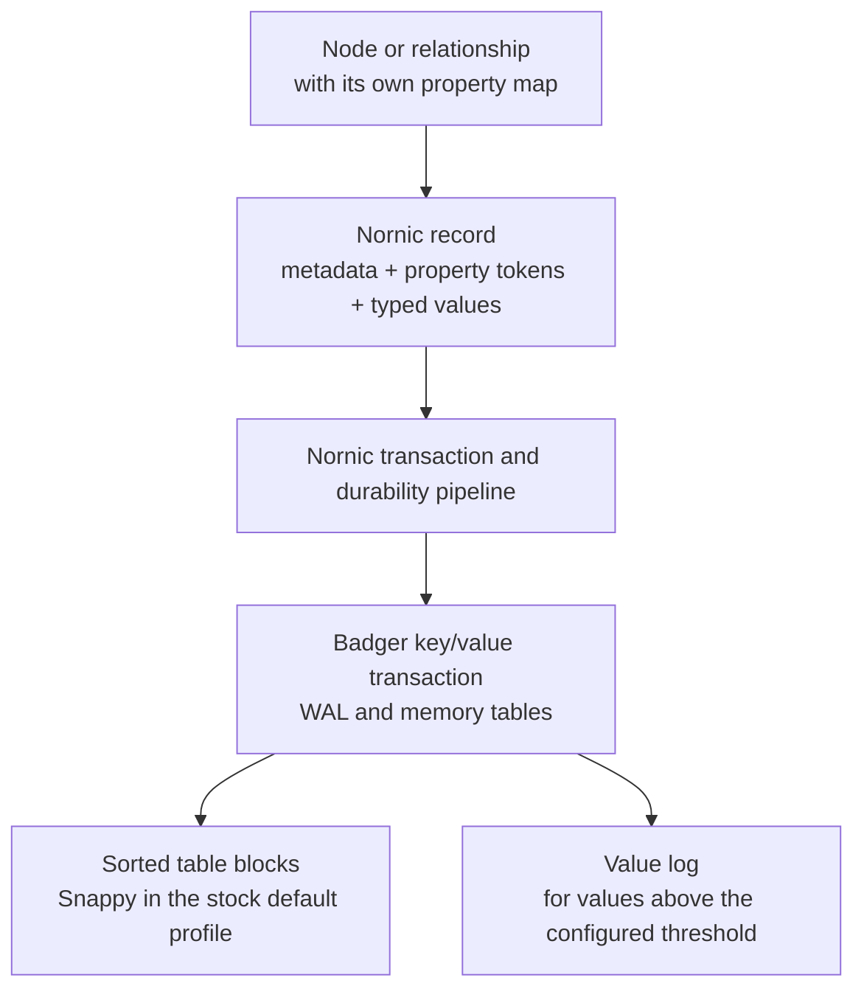
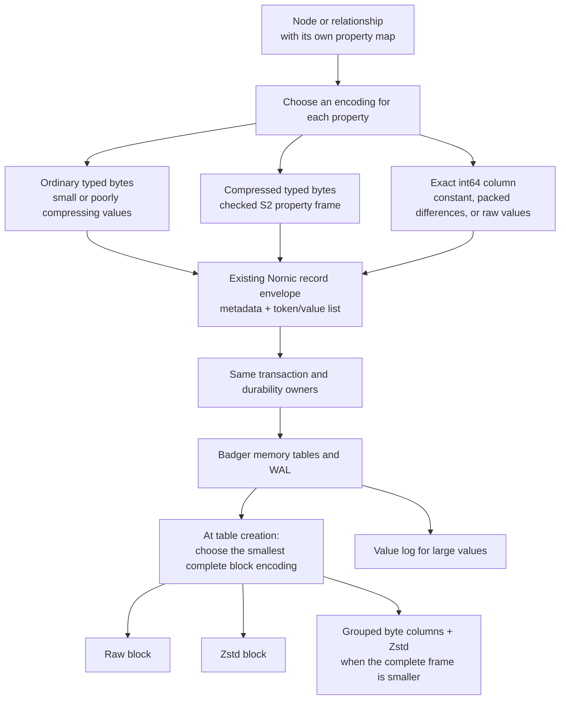
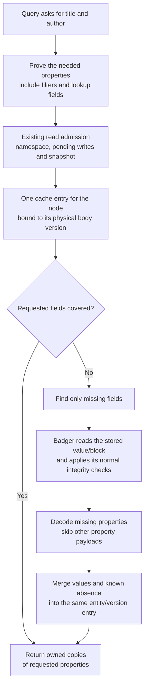

# Experimental storage, explained simply

Think of each node or relationship as a card with named facts on it. A card might
have a short title, a long document body and a list of numbers.

Stock storage packs the card into Badger. The experiment packs some facts more
compactly and teaches queries to unpack only the facts they request. A small cache
remembers facts already unpacked from that card.

Here, **stock** means the `release/v1.5.0` comparison source at `ddc59dc20`.
**Experimental** means this branch with
`NORNICDB_EXPERIMENTAL_PROPERTY_STORAGE_ENABLED=true`. The flag defaults to off.

## The old write layout

Badger is a key/value store. Nornic already has separate keys for nodes,
relationships, label indexes and adjacency indexes. A node's properties live
inside its record value; each property does not get its own Badger key.

Property names already have dictionary tokens. For example, a namespace might
assign `title` token 17. Each entity still has its own arbitrary set of properties.



A simplified node value looks like this:

```text
Node record
├── metadata: identity, labels, timestamps, stored embedding metadata
└── properties:
    token 17 → typed title
    token 23 → typed document body
    token 31 → typed number list
```

The indexed Cypher path used in our comparison hydrated all user properties even
when the result requested only a title. Projection APIs existed, but that path did
not carry the projection through the managed database wrapper.

## The experimental write layout

The keys, graph indexes and arbitrary property maps remain. Two packing steps
change the bytes inside values and table blocks.



### Packing one property

A long, repetitive document can take fewer bytes after compression. Random bytes
often cannot, so the encoder keeps their ordinary representation when compression
fails its savings check.

New compressed properties use the faster S2 codec with a checksum. Older Zstd
property frames remain readable. Badger's table-block compression is separate and
can still use Zstd.

A suitable integer list can also be packed exactly:

```text
Values:       100, 101, 102, 103
Store:        base 100, then small differences 0, 1, 2, 3
Read back:    100, 101, 102, 103
```

The integer codec uses constant values, fixed-width packed differences or raw
int64 values. It preserves the original integer values. Generic compressed
properties preserve their typed MessagePack representation.

A simplified experimental value looks like this:

```text
Same node record envelope
├── same metadata
└── properties:
    token 17 → ordinary typed title
    token 23 → extension frame containing compressed typed document bytes
    token 31 → extension frame containing an exact packed int64 column
```

Each node and relationship can have different property names and types. Tokens
identify names; they do not impose a shared table schema.

### Packing a table block

Nornic can tell Badger where recognized fields begin and end. Badger can group
matching byte spans before compressing the block. This is reversible byte
transposition: the decoder reconstructs the original block before normal reads.

```text
Before grouping:  [A0 A1 A2] [B0 B1 B2] [C0 C1 C2]
After grouping:   [A0 B0 C0] [A1 B1 C1] [A2 B2 C2]
```

Repeated byte patterns can then compress better. Field kind, token/ordinal and
span length determine which spans can be grouped. Values that the layout helper
cannot interpret remain opaque. A table records its encoding, so existing tables
keep their decoder when the flag changes.

## The experimental read path

For a supported property-only query, the query planner identifies the properties
needed by both the result and its predicates. The managed database wrapper now
forwards that request to storage.



For example:

| Request | Work | Cache after the request |
|---|---|---|
| `title` | Read the title | `title` |
| `title, author` | Read only the missing author | `title, author` |
| `author` | Use the cached author | `title, author` |
| `title, missingField` | Check the missing field once | `title, author`, plus known absence of `missingField` |

The cache has one entry per node, tied to a physical body version. It accumulates
fields; it does not create a cache entry for every combination of requested
properties. Concurrent fills merge their additions. Returned results contain only
the requested properties and cannot mutate the cached values.

A write revokes affected entries before the new data becomes visible. A pinned
snapshot keeps its own version checks. Complete-node reads require complete
images. Cache growth remains subject to the existing byte and entry budgets.

This cache diagram describes node projections. The experimental property encoders
also handle relationship properties; this change does not add a projected-edge
API.

## What this saves—and what still costs work

| Area | Intended saving | Remaining cost |
|---|---|---|
| Selected properties | Skip decoding and allocating unrelated values | Locate and frame the record's properties |
| Repeated projections | Reuse facts and lazily fill missing fields | Cache admission, version checks and owned result copies |
| Compressible data | Fewer stored bytes | Compression on writes and decompression on reads |
| Integer columns | Smaller exact number lists | Packing and unpacking |
| Byte-grouped blocks | Better compression across matching spans | Reconstruct the block before normal access |

**The I/O unit is still a Badger value/block.** Asking for one property can save
property decoding while still reading or decompressing its containing block.
Badger can also place large values in its value log. These diagrams do not claim
that every projection reads only the requested bytes from disk.

Compression and cache work can increase latency for some workloads. The
[measured point-read correction](POINT-PROJECTION-FIX.md) includes the remaining
mixed-query and cold full-body regressions. Further profiling is in progress;
those costs have not been declared acceptable without evidence.
The [regression follow-up](REGRESSION-FOLLOWUP.md) records the subsequent CPU and
allocation findings and corrections.

## What was removed

The unused NPR1 prototype added a separate directory with a 12-byte header and
24 bytes per property. It was never used by Nornic's runtime and did not establish
partial physical I/O through Badger. It was removed rather than retaining a second
record format for this correction.

## Follow the implementation

- [Property encoding and the canonical typed decoder](../../pkg/storage/property_codec.go)
- [Experimental property frames](../../pkg/storage/experimental_properties.go)
- [Physical layout hints](../../pkg/storage/experimental_column_layout.go)
- [Versioned body-cache owner](../../pkg/storage/badger_cache.go)
- [Projected body reads and lazy fill](../../pkg/storage/badger_snapshot_body.go)
- [Badger block codec](https://github.com/orneryd/nornic-badger/blob/dccab80b05b7934849a2e640b7e4d43a2cf1bc97/table/columnar.go)
