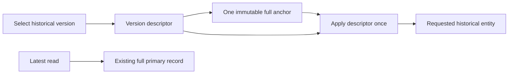

# Bounded historical reconstruction

Status: source audit and proposed experiment. Not implemented or benchmarked.
Implementation follows qualification of the current projection fixes. Any new
write format uses `NORNICDB_EXPERIMENTAL_PROPERTY_STORAGE_ENABLED`; readers must
continue to open existing stores when the flag is disabled.

## What the branch already does

The current primary key holds the full live entity. History is not uniformly a
set of full copies. With history retention enabled, updates archive inverse
property differences through `archiveNodeUpdateBodyInTxn` and its edge analogue
in [badger_mvcc_undo.go](../../pkg/storage/badger_mvcc_undo.go). Each record stores
the previous entity metadata, changed or removed property values, newly added
property names, and the next version's identity. Deletes archive a complete
record. Head-only retention with active readers also uses complete records,
because subsequent writes may legitimately skip history.

`resolveNodeUndoInTxn` and `resolveEdgeUndoInTxn` follow `Next` until a complete
record or the matching live head, then apply the undo records backward. An old
read can therefore perform work proportional to the number of later versions.
There is no constant-hop reconstruction guarantee in this implementation.

Exact versions use `loadMVCCRecordExactInTxn`. As-of reads first select the
greatest version at or below the requested cut using
`loadMVCCRecordAtOrBeforeInTxn` and `descendingPrefixKeys`, then reconstruct it.
Bounding reconstruction does not make an LSM seek, decompression, or returning
an arbitrarily large entity constant-time.

## First candidate: immutable anchor plus cumulative difference

Keep current reads on the existing full primary record. For historical versions,
test an immutable full anchor and one cumulative difference relative to that
anchor. A descriptor names an anchor directly; it must never name another
descriptor. Reconstructing one selected version requires its descriptor and at
most one anchor read, independent of update depth.

A cumulative difference contains all property changes and removals since the
anchor, not just the last write. It also carries the target metadata and preserves
the current historical embedding contract. Compare its complete encoded size
with a complete record; use a new anchor when a difference stops saving space.
This can bound read depth while costing more bytes than adjacent undo records
when many different fields change. Measure that tradeoff rather than assuming
both objectives improve together.

Anchors need independent lifetime ownership. A descriptor may outlive the
version at which its anchor was created, so ordinary version pruning must not
delete its anchor. Evaluate a separate anchor keyspace with transactionally
maintained references against bounded groups with explicit ownership. Reference
counts add write/conflict work; group ownership can retain unused bytes. Choose
only after measuring ordinary sparse and dense update workloads.

## Canonical integration boundary

The first prototype belongs in Nornic's existing archive, decode, resolution and
retention owners. Badger already supplies keyed reads and transactional writes;
the audit has not established a need to modify its MVCC machinery. Entity history
is Nornic's logical version keyspace, distinct from Badger's internal timestamps.

Required affected paths include direct updates, batched materialized commits,
deletes and recreation, exact and as-of node/edge reads, head rebuild, pruning,
backup/restore and reopening mixed legacy/new stores. The generic archive owner
is `archiveMVCCBodyInTxn` in
[badger_mvcc_commit.go](../../pkg/storage/badger_mvcc_commit.go). Reader admission,
reader retention cuts and prune scheduling live in
[badger_mvcc_prune.go](../../pkg/storage/badger_mvcc_prune.go); logical-key pruning
also resides in [badger_mvcc.go](../../pkg/storage/badger_mvcc.go).

Do not introduce a second history API or a projection-specific entity cache.
Do not rewrite existing history on startup. Existing undo records remain readable;
their measured chain cost must be identified separately from the new format.

## Experiment and acceptance evidence

1. Finish current projection regression qualification before enabling a new
   historical format. Preserve those binaries and receipts as the baseline.
2. Reproduce existing reconstruction depth with nodes and edges at 1, 8, 64,
   512 and 4,096 updates, including an active snapshot. Count record reads as
   well as wall time; separate exact selection from as-of selection.
3. Compare current undo storage, complete records and direct-anchor differences
   on the same frozen documentation corpus: sparse counters, field additions
   and removals, large unchanged text, high-entropy replacements and dense edits.
4. Profile the prototype before timing it. Report write latency, concurrency,
   historical p50/p95/p99, physical reads, allocations, retained memory and
   closed/compacted storage bytes. Keep compaction state and cache preparation
   comparable using the existing fixture receipts.
5. Prove public reads, deletes/recreation, pinned readers, pruning and reopen
   preserve exact values and identities. Include typed integers, float bits,
   missing versus null and caller ownership. Prove descriptor reconstruction
   uses at most one anchor at every tested history depth.
6. Retain a format only if its historical-read/storage tradeoff is supported
   by data and it preserves the already-qualified current-read/write behavior.
   Do not claim gains from helper benchmarks alone.

Periodic adjacent-delta checkpoints are a comparison candidate, not the preferred
first design: they bound a chain only by their checkpoint interval and still
require multiple applications. Per-property versioned keys are another candidate
if direct anchors fail, but introduce property discovery, tombstone and read
fan-out costs that must be measured through the same public APIs.
