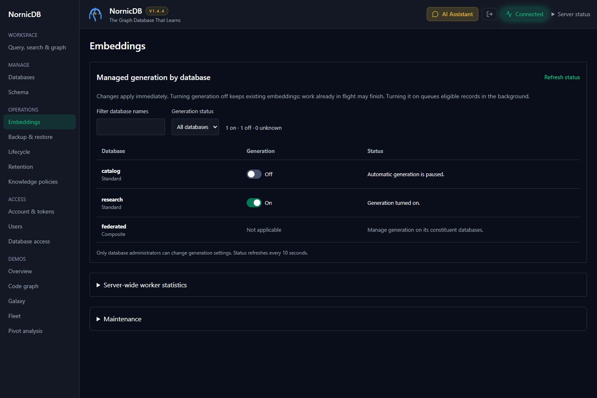
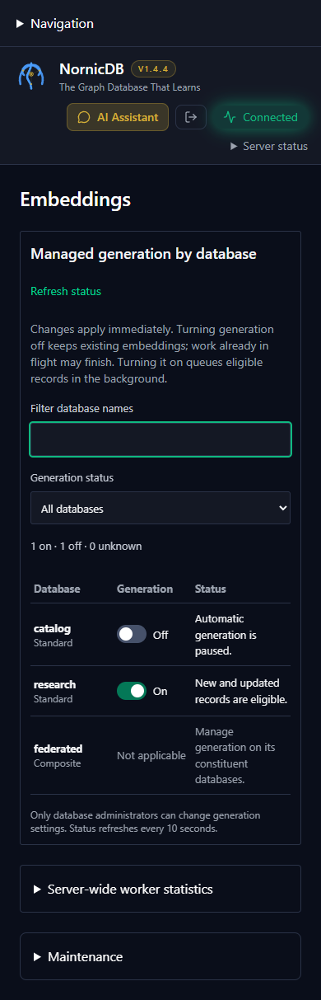

# Managed embedding controls

The Embeddings page starts with a database table: name, generation switch and status. Name/status filters and On/Off/Unknown totals support scanning. System and composite rows explain why they have no switch. Statistics and regeneration remain in URL-controlled disclosures below the primary task.

[NN/g toggle guidance](https://www.nngroup.com/articles/toggle-switch-guidelines/) supports switches for immediate binary settings. The table is deliberately a native table rather than an editing grid: there is one binary setting per row. Controls have named switches, visible state text, 44px hit height, keyboard focus, per-row pending/error/retry feedback and no extra Save step. Failed writes retain the confirmed state. Polling cannot overwrite a newer confirmed change.

## Runtime contract

`db.nornic.embedding.enabled` is a dynamic database admission setting. Startup restores each database's persisted gate. Both pending-node admission and retry selection honor it. Existing vectors are retained; already-claimed work may finish. Enabling requests the existing worker's background index refresh so writes made while off are discovered. No request-scoped scan goroutine or new storage format is introduced. A configured server worker is still required; the switch does not load a provider or disable vector search.

The UI reads active configuration and submits only the one setting with `PATCH /admin/databases/:database/config`. The existing config handler merges submitted overrides before its normal validation/persistence/hot-reload path. Unrelated overrides, including redacted provider credentials, stay intact. PUT remains full replacement. Existing admin/database-write permission checks apply to PATCH.

## Verification

- Reproduced the old restart-only defect through the HTTP config API before implementation.
- New worker tests cover database isolation, writes while off, background resume, existing-vector preservation and retry pause/resume.
- Config HTTP tests cover immediate effective values, preserving unrelated overrides, restart persistence and unauthorized/read-only denial.
- Normal worker checks passed. One broad race run failed without retaining its full diagnostic output; the captured rerun passed all 723 tests/subtests (126.8s). No assertions were changed to obtain that pass.
- Focused storage checks passed under the race detector (200.7s). Seven pre-existing release test files needed nine ordinary transaction calls updated to the required `OrdinaryBegin` argument; assertions are unchanged.
- Final server/config checks passed. The affected browser suite passed all 18 cases, including mobile accessibility scans, URL filters, failed-save retry, old-refresh ordering, regeneration scope and existing section navigation. Production UI builds passed.
- Screenshots use fixture data; no production database was changed by these tests. Browser coverage is Chrome. Existing Vite warnings and the separately recorded grid accessibility limitations remain.

