# Workspace layout and interaction map

The workspace is organized around database scope, activity and selected-record inspection. The design applies NN/g guidance to existing developer tasks; it does not claim usability-study validation. Review screenshots use deterministic fixture data.

## Intent and placement

| Existing component / controls | User intent | Placement and behavior | NN/g basis |
| --- | --- | --- | --- |
| Application navigation, skip link, mobile navigation disclosure | Move between tasks; reach content by keyboard | Existing navigation retained; workspace content uses the same quiet surfaces and small corner radius | Consistency and standards; user control |
| Header brand, version, connection indicator, server status | Identify context; know whether the server is available | Compact utility header; textual connection state; server-wide metrics stay in a disclosure | Visibility of system status; progressive disclosure |
| Assistant and sign out | Get help or end a session | Secondary header actions; only Run Query receives primary visual emphasis in the query activity | Aesthetic and minimalist design; consistency |
| Database selector and node/edge counts | Choose the target and confirm scope before acting | One shared context strip above all modes; counts reflect that database, not global totals | Error prevention; visibility of system status |
| Query, semantic search and graph tabs | Choose how to work with the same data | Stable horizontal activity row; existing arrow/Home/End keyboard behavior and URL state retained | Recognition rather than recall; consistency |
| Query editor, autocomplete switch, query history | Compose or reuse a statement | Full available width; visible labelled editor tools, history adjacent to input; resizable editor | Recognition rather than recall; flexibility and efficiency |
| Run, keyboard shortcut, continue-on-error | Execute intentionally; choose multi-statement behavior | Run below editor on the left; optional execution settings on the right, with disclosure state in URL | Proximity; progressive disclosure; error prevention |
| Statement progress, duration, errors and success | Understand execution and recover | Existing messages remain next to the affected statement/results | Visibility of system status; error recovery |
| Empty query area and sample query | Know the next step before any results exist | Short guidance in the result area; sample fills editor without executing | Help and documentation; user control |
| Result grid, sort/pin menus, expandable cells and row details | Scan results and reveal detail | Full-width result region beneath editor; existing grid functions and URL bridge retained | Recognition; progressive disclosure |
| Row selection, bulk clear/delete, confirmation dialog | Act on an explicit set of records | Bulk toolbar appears when there is a selection; destructive confirmation retained | Error prevention; minimalist design |
| Semantic search input, submit, result scores and cards | Find information by meaning, compare relevance | Same content alignment as query activity; explanatory text above input; selected node opens inspector | Match to user intent; recognition |
| Search checkboxes / select all | Choose records for bulk actions without opening them | Separate labelled checkbox and inspection button; labels identify the record | User control; accessibility |
| Graph root/depth/refresh, neighborhood filters, include/exclude chips | Explore relationships and bound the neighborhood | Existing graph tools stay together; advanced filters remain disclosed on demand | Progressive disclosure; error prevention |
| 3D scene, fit/focus, pause, pins, labels and keyboard camera controls | Orient, stabilize and navigate the graph | Graph takes the main activity area; controls, legend and keyboard equivalents retained | User control; flexibility and efficiency |
| Graph keyboard node/relationship lists and filtering | Explore without pointer or 3D interaction | Existing discoverable lists retained below scene | Accessibility; alternative interaction paths |
| Inspector identity, properties, embedding/policy metadata and ranking | Understand the selected node/relationship | Contextual right rail appears only for selection; identity and metadata remain together | Proximity; progressive disclosure |
| Typed property edit, save/cancel, read-only values and refresh | Make an intentional change and confirm it | Existing routed edit state and controls retained within inspector | User control; error prevention; status visibility |
| Find similar and related items | Follow a discovery from the selected record | Existing contextual inspector action retained | Recognition; contextual help |
| Close inspector | Return space to the current task | Explicit close button; desktop rail; mobile collapsed bottom disclosure, opening a nonmodal panel with independent scrolling | User control and freedom |
| AI chat, delete and regeneration dialogs | Complete existing auxiliary flows | Existing components/handlers retained; regeneration remains on Embeddings, not added to workspace | One owner per task; error prevention |

## Visual system

Keep the navy, emerald, blue and gold palette. Use borders to separate regions, 3px corners on workspace controls, no connection glow, and neutral secondary actions. Keep rounded data visualization marks where their shape carries meaning. Workspace and management surfaces use the existing navigation as their visual reference; shared grid theme variables also keep pinned cells opaque.

## Verification

Production build passes. Focused browser checks cover database routing/counts, reload and history, mode tabs, query execution by keyboard, options/history URL state, contextual inspection, semantic results, mobile overflow, 3D scene and keyboard graph controls. Screenshots are captured after results/controls render.

Accessibility scans run over every prototype screenshot state. Full reports are attached to Playwright output. The existing third-party result grid still has selection ARIA defects (unnamed checkbox, aria-checked on a button) and its previously recorded required-child-role defect. The layout checks exclude only that grid when asserting no other WCAG A/AA violations; no upstream patch or dependency change is included. These scans do not establish full accessibility or usability conformance.

## Guidance

- [NN/g: consistency and standards](https://www.nngroup.com/articles/consistency-and-standards/)
- [NN/g: progressive disclosure](https://www.nngroup.com/articles/progressive-disclosure/)
- [NN/g: recognition rather than recall](https://www.nngroup.com/articles/recognition-and-recall/)
- [NN/g: usability heuristics](https://www.nngroup.com/articles/ten-usability-heuristics/)

## Editing recommendation

Use an explicit edit session in the selection inspector for heterogeneous graph properties. Keep query results for scanning/selection, not automatic per-cell writes. Structured administration grids can still use their existing inline editing: they have known columns and row-level save/error feedback. This recommendation is specific to the workspace's arbitrary property maps.

| Intent | Prototype control / behavior | NN/g rationale |
| --- | --- | --- |
| Change a value | Visible property label and typed control; string textarea, finite-number input, True/False select, multiline JSON | Match controls to data; recognition; reduce guessing |
| Rename a property or change its type | Name/type disclosure under the value; stable draft identity while typing | Progressive disclosure; preserve focus and user control |
| Add a property | Labelled Add property action creates a draft; name/type/value stay together | Clear next action; visual grouping |
| Remove a property | Stage removal, show its name and Undo; no network write until Save | Error prevention and recovery |
| Understand pending work | Unsaved-change count and optional named change list | Visibility of system status |
| Validate a value | Field-adjacent messages after blur/save; focus first invalid control; preserve draft | Error recognition and constructive recovery |
| Prevent accidental key replacement | Reject duplicate names and server-managed names before any request | Error prevention |
| Commit or abandon | Explicit Save changes / Cancel at the inspector footer | User control; match form expectations |
| Recover from server failure | Keep values/removals and show a retryable inline error | Preserve work; actionable error feedback |
| Confirm success | Show Changes saved and use the returned record in the inspector | Visibility of system status |
| Inspect computed metadata | Read-only server-managed disclosure; no editable control | Honest affordances; progressive disclosure |
| Reproduce the UI | `/nodes/:id/edit` and disclosure query parameters; property values stay out of the URL | Consistency; separate view state from draft content |

The previous property-name-keyed React state remounted a field while its name changed. Draft rows now have stable IDs. The previous client update built only SET clauses, so omission from the form did not remove a stored property. Staged removals now generate an explicit REMOVE clause; property identifiers are quoted and values remain parameters. The server API and server source are unchanged.

This prototype edits node properties only, matching existing capability. Relationship inspection, schema tools and administration remain in their existing owners. Save/removal checks use mocked HTTP responses and assert the generated Cypher, typed parameters, scope and resulting UI; they are not a live-database mutation test.

Dirty edit sessions now warn before leaving their context. Keep editing preserves the draft; Discard changes and leave completes the requested navigation. The same guard covers record edits, database creation/settings and schema creation. Successful Save and explicit Cancel clear the guard. Browser reload/close uses the native beforeunload warning. Disclosure and other non-destructive view-state changes do not prompt. Draft values are not persisted across reloads; no autosave or browser-storage persistence was added.

Guidance: [NN/g on explicit save expectations](https://www.nngroup.com/articles/efficiency-vs-expectations/), [form error feedback](https://www.nngroup.com/articles/errors-forms-design-guidelines/), and [form structure](https://www.nngroup.com/articles/web-form-design/).

Run `npm test --prefix ui` and `npm run test:browser --prefix ui`. The browser configuration builds and serves static assets so generated trace HTML cannot reload the application during a test.

## Review feedback incorporated

- Selection, row expansion and Inspect remain pinned together. The shared grid URL bridge preserves action columns declared fixed even when an older URL contains an empty pin map. Other column pins remain user controlled.
- Pinned cells have opaque row/selection/focus surfaces above scrolling content; headers use their own opaque surface.
- A row has one canonical full-value disclosure. Node cells are summaries; long strings and JSON previews are bounded with ellipsis. The row's full data remains in expanded details.
- Find similar is a separate inspector activity with source-record context, loading, explicit errors, Retry/Refresh, scores, Inspect and Back to details. Choosing a match opens its record while leaving query results intact.
- Database management uses flat database rows with labelled CTAs. Open workspace, Schema, Settings, Details, Lifecycle and Delete retain their original scope/availability. All original metrics and composite constituents remain.
- Database details, database creation and schema creation are routed tasks, not modal overlays. Settings occupy their existing edit route without the catalog above them. Schema creation places its definition preview beside the fields.
- Destructive database deletion and schema drop remain confirmations with a safe Cancel action. Existing unsaved-change warnings also remain dialogs because an explicit decision is needed before discarding work. Other untouched application dialogs were inventoried but not broadly rewritten in this prototype.
- The sample query action now focuses the editor and announces that the sample was loaded. It intentionally does not run a query automatically.

Fixture tests assert existing HTTP/Cypher requests and UI outcomes. This change does not modify the Go server or database formats.

## Verification and limits

The review covers unit checks, the production UI build, browser navigation, typed edits and failed-save retry, unsaved navigation/reload warnings, database/schema creation, default-database routing, mobile layouts, 3D graph controls, and horizontal scrolling with long JSON values. On the release branch, `npm test --prefix ui` passed all 26 unit checks and `npm run test:browser --prefix ui -- --workers=1` passed all 49 browser checks. The browser command also completed the production UI build. Existing Vite config/chunk-size warnings remain. No Go/backend suite was run for these UI changes.

Screenshots below and in [the screenshot folder](prototype/) use fixture data. Known upstream grid selection ARIA issues are recorded in the accessibility section above; this change does not patch the dependency. Browser viewport checks use Chromium/Chrome, not a Safari or Firefox compatibility matrix.

Modal policy follows [NN/g's modal and nonmodal dialog guidance](https://www.nngroup.com/articles/modal-nonmodal-dialog/): use focused dialogs for short consequential decisions, and retain access to context for longer creation, configuration and inspection activities. The component choices in this prototype are our application of that guidance, not a claim that NN/g prescribes one layout for every task.

## Screenshots

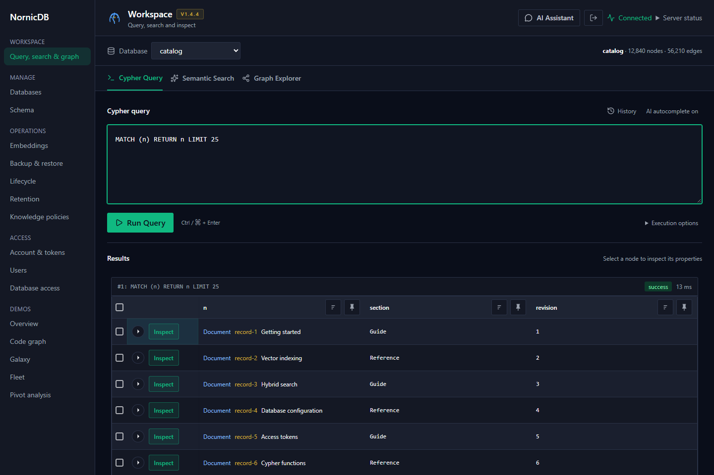
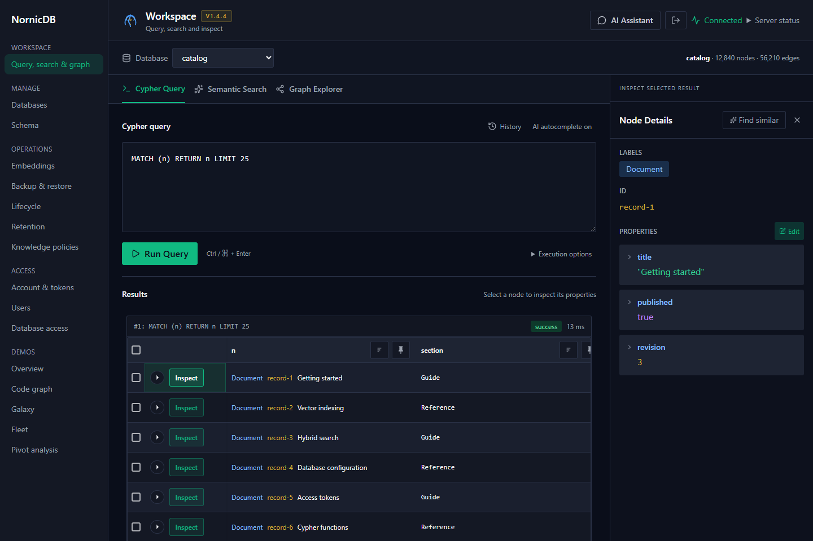
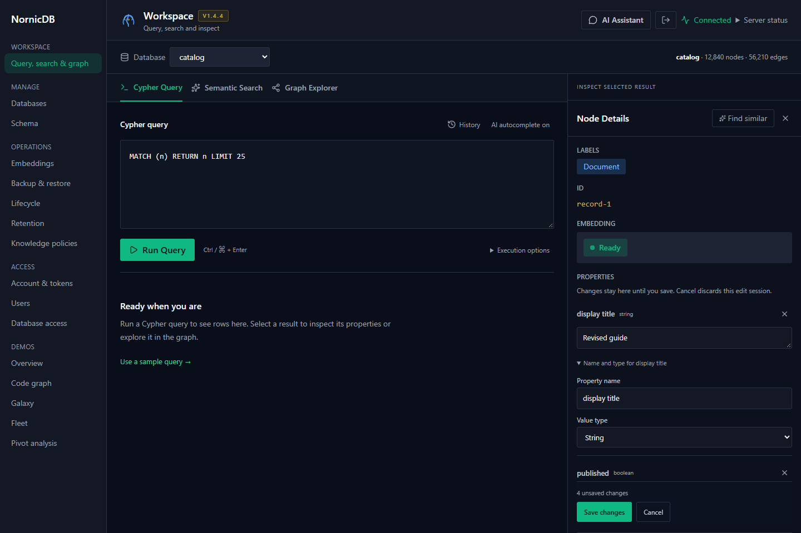

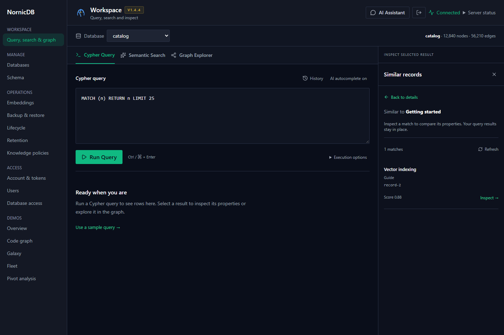
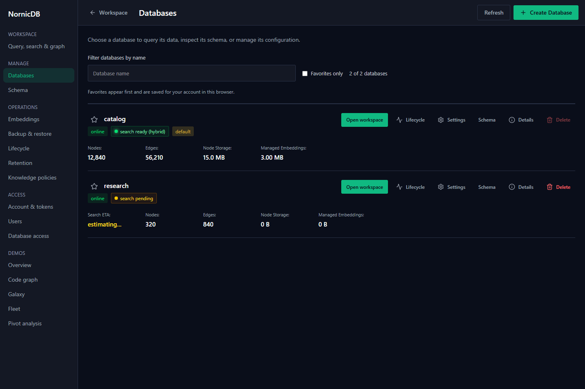
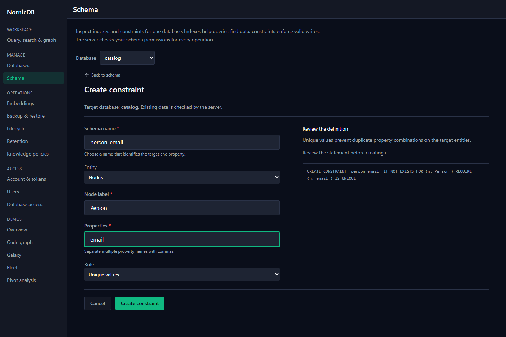
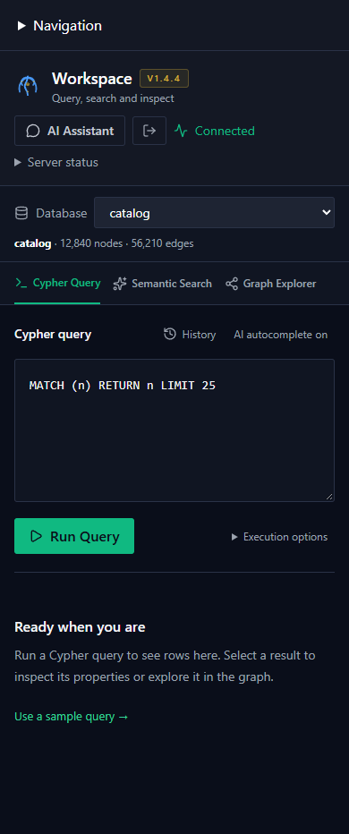
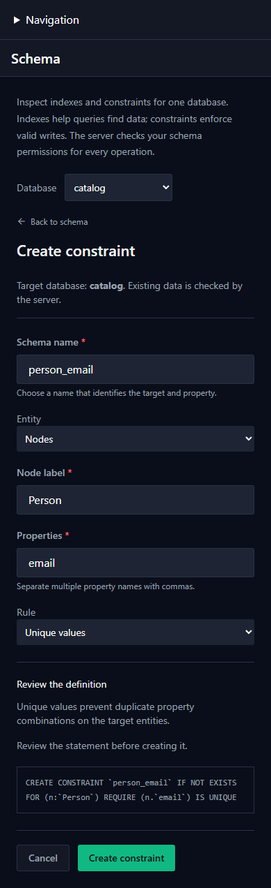

### Dialog positioning regression

The shared native dialog explicitly uses viewport-fixed insets and automatic margins. Width limits belong to the dialog itself; its inner panel has no asymmetric horizontal margin. Geometry checks cover unsaved record, schema and database edits at desktop and mobile viewports, including safe initial focus and Escape preserving the draft. All six positioning cases and 15 related editing/operation checks passed (`npm run test:browser --prefix ui -- modal-position.spec.mjs workspace-editing-prototype.spec.mjs operations.spec.mjs --workers=1`).

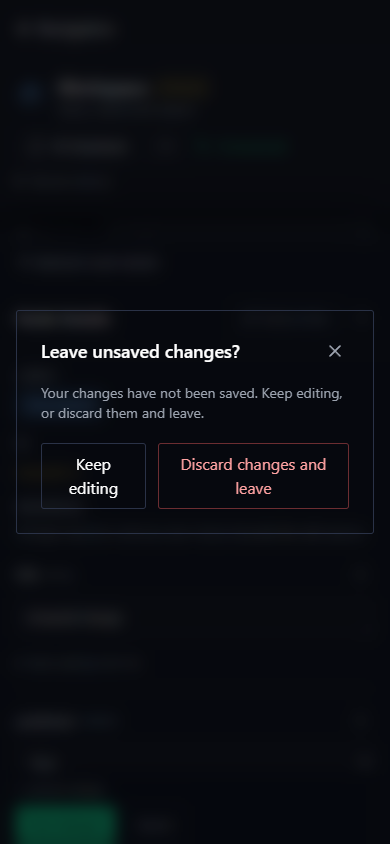

## Compact grids and wide-screen layout

One theme in `index.css` sets grid text to .75rem (12px at the default root size, 25% below the 1rem host default), tighter supported cell/filter padding, flat corners and the existing palette. Custom small-text renderers use the same scale. Page typography is unchanged. Filters retain visible focus; coarse-pointer filter padding and the clear action retain larger targets. Headers and data-heavy pages use available width; backup/account forms and explanatory text retain readable limits.

The shared `StatefulGrid` owns filter summaries and the clear action. The summary reads the same saved URL state as the grid, including the SDK's actual `activeFilters` runtime field. A narrow viewport keeps identifying left pins but releases right pins so actions do not hide all other columns. Desktop saved views remain the input to that responsive presentation.

| Area | User intent | Presentation decision |
| --- | --- | --- |
| Query results | Compare values, select records, inspect full values | Compact grid; record editing stays in the inspector form |
| Users | Compare identity, roles, status; edit an account | Pinned identity grid; explicit edit controls and save feedback |
| Database access | Compare grants and entitlements | Grid with column filters |
| Database configuration | Find settings and compare overrides with defaults | Filterable key/value grid with typed controls |
| Schema | Compare indexes/constraints; create a definition | Grid for inventory; routed form for creation |
| Lifecycle | Compare reclamation debt and readers | Read-only grids for structured diagnostics |
| Retention | Compare policies and act on a policy | Filterable grid with explicit actions |
| Knowledge policies | Compare profiles/bindings; define targeting rules | Grids for comparison; existing guided forms for authoring |
| Pivot demo | Compare aggregates and inspect underlying orders | Grid and detail sub-grids |
| Database catalog and record details | Choose a database/task; inspect/edit one record | Existing list and forms retained; no grid added |

This applies [NN/g's data-table task guidance](https://www.nngroup.com/articles/data-tables/): support finding, comparing, editing and acting on records, and make filtered state apparent. The particular density and breakpoint are our design choices.

Upstream issues filed during this iteration: [saved-state runtime/declaration mismatch #7413](https://github.com/orneryd/ui-grid/issues/7413) and [column filter accessible names #7414](https://github.com/orneryd/ui-grid/issues/7414). Existing [virtualization #7410](https://github.com/orneryd/ui-grid/issues/7410) and [grid semantics #7411](https://github.com/orneryd/ui-grid/issues/7411) remain tracked. No third-party code was patched. Default column filter names remain an upstream accessibility limitation.

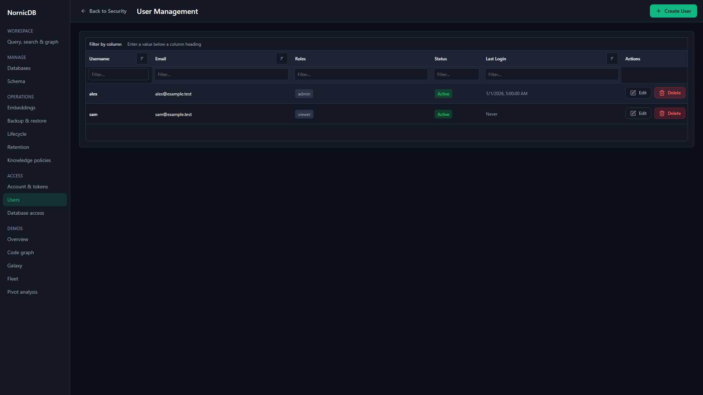
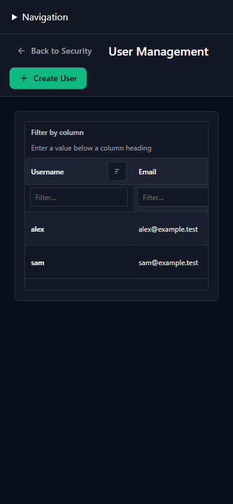
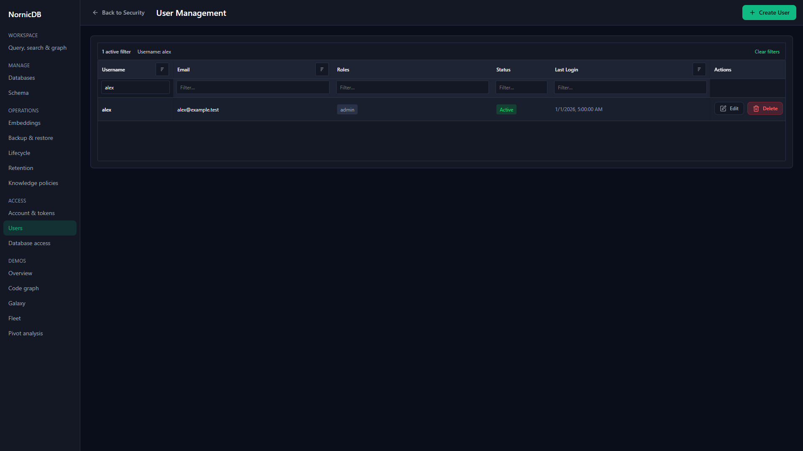

### Database filters and browser favorites

The catalog filters names case-insensitively and exposes the filter and Favorites only selection in URL query parameters. Star buttons have pressed states and explicit database names. Favorites sort first and persist only in this browser's local storage, scoped by application base path and authenticated username; they do not change database metadata or permissions. Storage failures appear in the catalog. An empty filtered list explains how to recover.

All body cells use the exported grid part to center their content vertically, including custom renderers. The grid's own cell shell retains horizontal alignment and row controls.

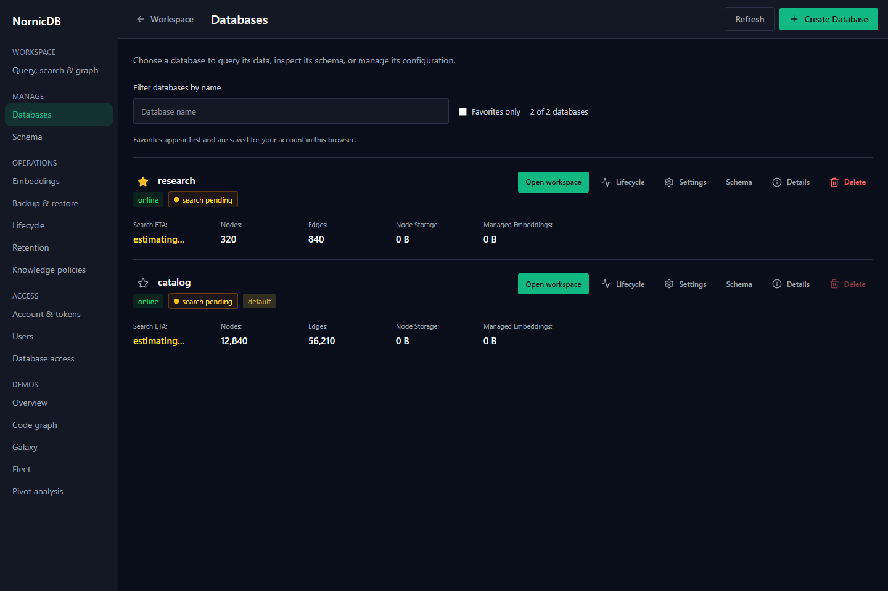
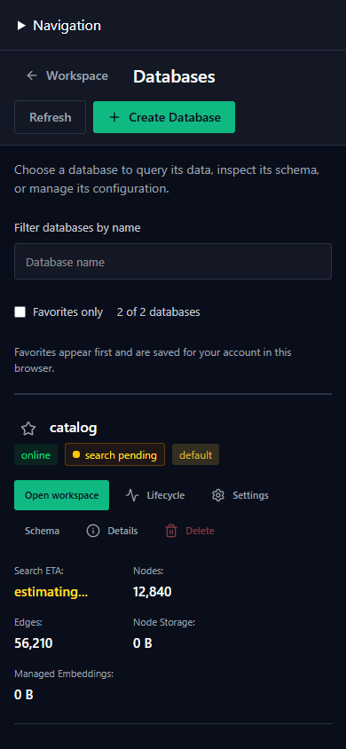

Compact-layout verification: the full 56-case browser suite passed before the catalog additions. After adding favorites and vertical alignment, 22 focused checks passed; the final cell-layout revision passed all 15 catalog/grid/management/pivot checks. The shared production build passed with each run. The unit suite passed all 26 checks. These use fixture APIs in Chrome; no production database writes were performed by these checks.
